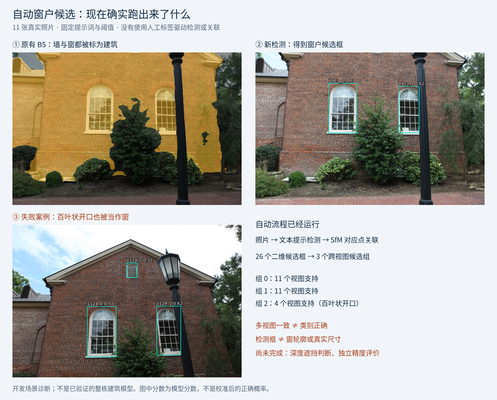

# 问题与改动记录 · 2026-11-16

[下载问题与改动汇报 PPT](research_progress_20261116.pptx) · [逐页讲稿](speaker_notes.md) · [成果与边界](REPORT.md) · [数据说明](DATA.md)

**交付定位：改动材料与试图解决的问题，尚未证明工程问题已解决。**

[问题—改动—证据—未解决项对照表](CHANGES_AND_PROBLEMS.md)



## 已执行的改动与尝试

- 冻结局部基线：11视图、3696稀疏点、25335次观测；几何加权与多数票预测相同。
- 自动检测：11张真实照片得到26个候选框，关联为3组（支持视图数11/11/4）。
- 失败案例：顶部百叶状开口在4张照片中重复被当作窗；多视图一致不保证类别正确。
- 合成压力测试：单一假想几何下3条件×20噪声种子×6方法；结果与真实数据严格区分。

## 复现

这是本次汇报的独立快照，不改变仓库根目录旧版流水线。

已有环境使用 Python 3.14、torch 2.14.1+cu130、transformers 5.19.0、numpy、Pillow、huggingface_hub。检测脚本当前需要CUDA；不声称已验证CPU执行。权重从官方模型仓库下载，原始图像和COLMAP文本模型需自行准备；本目录未附完整场景或模型权重。

```bash
python reproduce/scripts/detect_windows.py --images /path/to/images --output /path/to/new_run --revision a2bb814dd30d776dcf7e30523b00659f4f141c71
python reproduce/scripts/associate_windows.py --model /path/to/colmap/sparse/0 --run /path/to/new_run
python reproduce/scripts/run_synthetic.py
```

前两步固定处理 IMG_1118.JPG 至 IMG_1128.JPG；关联读取 images.txt/points3D.txt。输出JSON是模型预测，不是人工真值。合成脚本在其旁边创建 SYNTHETIC_ONLY；其中网格只是平面，不是现实建筑mesh。发布版仅将机器绝对路径改成CLI参数，关联已对相同冻结检测重放验证。

## 结果适用范围

单个已查看开发场景。没有独立实例IoU、检测AP、尺度或完整mesh评价。100点人工标注曾受墙类别选项缺陷影响，不把该组宏IoU列为最终论文成绩。运行不需人工逐点审核；科研有效性仍需独立真值检验。

模型来源：[Grounding DINO tiny](https://huggingface.co/IDEA-Research/grounding-dino-tiny)。其贡献归原作者；本次工作是工程集成和诊断，不宣称发明检测器或证明融合新颖性。
